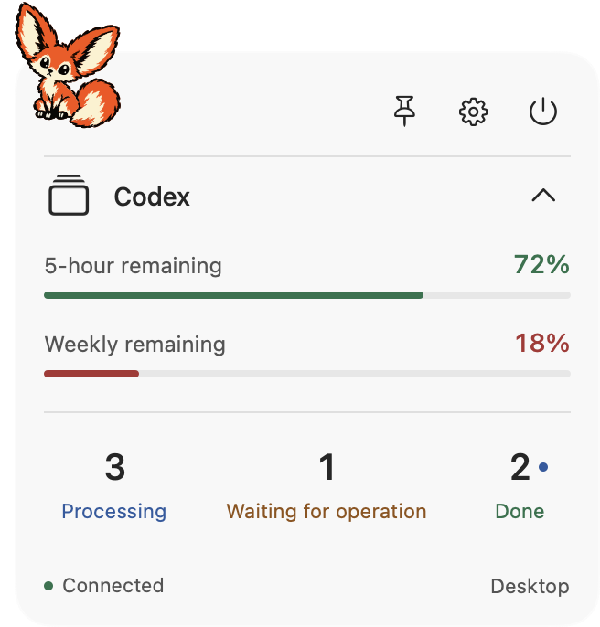

# Status Board

为 Codex 桌面端设计的原生 macOS 状态面板。在桌面上查看正在处理、等待操作和已完成未读的任务，以及账户可用额度；任务需要关注时，通过短提示音提醒你。

基于 **SwiftUI + AppKit**，支持可拖动的红狐头像、展开面板、置顶和菜单栏入口。当前版本为 **0.2.2 · build 39**，处于个人预览阶段。

> 状态来自当前账户可验证的本地会话。面板显示已同步范围内的数据，不代表整个账户的全部任务；可在 **Info** 中查看同步覆盖率和各项功能的可用性。



*界面示例使用合成数据，不代表真实账户额度或任务。*

## 开源许可与使用声明

项目维护者有权授权的自有代码、脚本、文档、当前红狐素材及项目生成音效采用 **[MIT License](LICENSE)**，允许按许可证条件使用、修改、再分发和商业使用。第三方材料保留原有许可。

**当前红狐头像、睡眠头像、狐狸头部及尾巴图标由维护者使用 GPT 生成；据维护者确认，未参考已有图片。维护者对这些素材及衍生应用图标有权授予的权利按 MIT 提供。** 旧版 Joker / 皇冠素材已从当前源码与新发布包移除，其历史授权记录仍保留在 [第三方资源与素材声明](THIRD_PARTY_NOTICES.md)。

Status Board 是独立维护的第三方预览工具，不是 OpenAI 或 Apple 官方产品，不表示获得其认可或背书。软件按适用许可证所述的“现状”提供，任务、额度和提醒可能不完整或不准确；责任限制仅在适用法律允许的范围内生效，不排除法定不可排除的责任。

- [预览版使用与责任说明](DISCLAIMER.md)：功能边界、非官方关系、安装风险、维护与责任限制。
- [隐私与本地数据说明](PRIVACY.md)：账户核对、缓存与日志、第三方联网行为、数据清理。
- [第三方资源与素材声明](THIRD_PARTY_NOTICES.md)：SQLite、Liquid-TUI 归档及素材授权范围。
- [安全报告说明](SECURITY.md)：安全问题联络流程；当前未启用 GitHub 私密漏洞报告，请勿公开提交敏感细节。

## 下载与安装

**[下载 0.2.2 build 39 预览版（macOS 通用 ZIP）](https://github.com/IntegrityXu/Agent_dashboard/releases/download/v0.2.2-preview.39/StatusBoard-0.2.2-build39-macOS-universal.zip)** · [发布说明与所有版本](https://github.com/IntegrityXu/Agent_dashboard/releases)

下载前请阅读上述声明及预览版限制。自 build 39 起，应用包的 `Contents/Resources/Legal/` 随附 MIT 许可证、免责声明、隐私说明、第三方资源声明和安全报告说明；可在 Finder 中右键应用，选择“显示包内容”查看。

下载使用无需 Xcode、Swift 或 Python。需要 **macOS 15.0 及以上**，并已安装、登录且运行 Codex macOS 桌面端。应用包包含 **Intel（x86_64）与 Apple Silicon（arm64）** 两种架构；现有实际运行验证来自 Intel Mac，完整 Apple Silicon 运行验收仍待完成。

1. 下载 `StatusBoard-0.2.2-build39-macOS-universal.zip` 并解压。Releases 中自动生成的 `Source code (zip)` / `Source code (tar.gz)` 是源码，不是可直接运行的应用。
2. 将 `Status Board.app` 拖入“应用程序”（Applications）文件夹，再双击打开。
3. 首次启动会显示红狐头像；点击头像展开面板。应用以菜单栏程序运行，不显示普通 Dock 图标；找不到面板时，从菜单栏选择 **Show Status Board**。

### 首次打开与预览版限制

当前预览版仅使用本地 **ad-hoc 签名**，尚未使用 Apple Developer ID 正式签名，也未经 Apple 公证。macOS 可能提示无法验证开发者或无法检查恶意软件。

仅在确认下载来自本仓库、且愿意运行此预览版时，先尝试打开应用，然后到 **系统设置 → 隐私与安全** 中找到对应提示，选择 **仍要打开（Open Anyway）**，按系统提示确认。详情见 [Apple 的应用安全说明](https://support.apple.com/zh-cn/102445)。受管理的 Mac 可能不允许此操作。

每次发布附带 `SHA256SUMS.txt`。如需检查下载是否完整，将它与应用 ZIP 放在同一目录，在该目录的终端执行：

```sh
shasum -a 256 -c SHA256SUMS.txt
```

校验值只能检查文件一致性，不能替代正式签名与公证。预览版的功能覆盖和已知限制见下文。

### 更新与卸载

- **更新**：从 Status Board 菜单退出旧版本，下载并解压新版本，将“应用程序”中的旧应用替换，再重新打开。位置和显示偏好会保留；当前没有自动更新功能。
- **卸载**：如果曾开启 **Launch at Login**，先关闭它；退出应用，再将“应用程序”中的 `Status Board.app` 移到废纸篓。偏好、额度缓存和日志不会随之自动删除，清理方法见 [隐私说明](PRIVACY.md#6-停止处理与删除本机数据)。

## 功能

- **任务状态**：查看 Processing、Waiting for operation 和 Done，支持已验证的本地临时侧聊。
- **未读完成恢复**：启动或重连后恢复可验证的已完成未读任务，在 Codex 中阅读后自动更新。
- **Agent 活动**：任务处理期间显示主 Agent 和子 Agent 的活动行；子 Agent 不重复计入顶层任务数量。
- **账户额度**：展示 Codex 提供的额度周期；连接异常时可保留同一账户的已验证缓存，并标记为 Saved。
- **桌面交互**：头像与面板切换、拖动、置顶、详情折叠，自动保存位置和显示偏好。
- **声音提醒**：完成、等待操作、停止错误使用不同短音效，支持一键静音。
- **菜单栏与设置**：快速找回面板、刷新连接、打开 Codex、查看 Info，以及按需开启登录启动。

## 从源码构建

以下开发环境仅供自行编译或参与开发的用户使用。

| 项目 | 要求或已记录的验证环境 |
| --- | --- |
| 系统 | macOS 15.0 及以上；现有运行验证来自 Intel macOS 15.8.1 |
| Codex | 已安装并登录 Codex macOS 桌面端；实时任务监控需要桌面端运行 |
| 开发工具 | 完整 Xcode，包含 Swift 6.2 或更新的兼容工具链 |
| 已验证工具链 | Xcode 26.3、Apple Swift 6.2.4、macOS 26.2 SDK |
| 辅助工具 | 原生窗口验证与音效再生成需要 Python 3 |

Swift Package 使用本地模块，没有远程包依赖。项目内置固定版本的 SQLite 源码，详情见 [SQLite 说明](Packages/StatusBoardCore/Sources/StatusBoardSQLite/vendor/README.md)。Release 构建已有通用二进制验证记录；完整的 Apple Silicon 运行验收仍不能由 Intel 测试替代。

### 构建与启动

```sh
git clone https://github.com/IntegrityXu/Agent_dashboard.git
cd Agent_dashboard

# 编译 Release、打包并进行本地 ad-hoc 签名
./scripts/package-app.sh

# 启动应用
./scripts/run-app.sh
```

构建完成后，也可以双击 `dist/Status Board.app`。应用包使用红狐头部图标；应用以菜单栏程序运行，菜单栏使用 `fox-tail-open-ring.svg` 狐狸尾巴图标，不显示普通 Dock 图标。

应用图标资源为 `StatusBoard/Resources/AppIcon.icns`，包含标准与 Retina 尺寸，源图为 `StatusBoard/Resources/fox-red-head.svg`。替换应用图标源图后，运行 `bash scripts/generate-app-icon.sh` 重新生成图标，再打包应用。

Dashboard 悬浮头像使用非睡眠版 `StatusBoard/Resources/fox-red.svg`，在连续 30 分钟未观察到 Codex 会话活动后自动切换为 `fox-red-sleeping.svg`，新活动会恢复清醒图；任务执行期间保持清醒，定时刷新和额度查询不重置空闲计时。应用启动时重新计时。

首次启动显示未置顶的红狐头像；点击头像展开面板，拖动头像或面板顶部空白区域移动位置。之后启动会恢复上次的位置、置顶和展开状态。

`run-app.sh` 仅在应用包不存在时自动打包。**修改源码或拉取更新后，请先重新运行 `package-app.sh`**，再启动新构建；若旧版本正在运行，应先从其菜单退出。

当前打包使用本地 ad-hoc 签名；下载预览版的安装方式及首次打开说明见上方“下载与安装”。

## 使用说明

| 操作 | 行为 |
| --- | --- |
| 点击红狐头像 | 在紧凑头像和展开面板之间切换 |
| 拖动头像、顶部或 Codex 行的非按钮区域 | 移动面板，保持原应用的输入焦点 |
| 点击 Pin | 切换置顶状态 |
| 点击详情箭头 | 隐藏或显示额度和任务统计 |
| 点击任一任务数量 | 打开 Codex，不选择或修改具体会话 |
| 菜单栏 → Show Status Board | 展开并临时前置面板，不改变置顶偏好 |
| 菜单栏 → Pin / Unpin Status Board | 切换置顶并显示面板 |
| 菜单栏 → Keyboard Settings… | 临时进入键盘设置；支持方向键、Tab、回车，Esc 返回原工作窗口 |
| Settings → Info | 查看连接状态、同步范围、账户范围和各数据源状态 |
| Settings → Mute Sounds | 立即停止正在播放与排队的提示音，并保存静音偏好 |
| Settings → Launch at Login | 通过 macOS 管理登录启动；需要批准时打开系统设置 |
| 点击电源按钮或 Quit | 确认后退出 Status Board 及其自身的辅助进程 |

普通点击、拖拽、置顶、展开/收起以及鼠标操作设置不会抢走原应用的键盘焦点。Keyboard Settings、Info 和退出确认按需临时获取焦点，结束后返回原工作窗口；若期间已切换到其他应用，则不强行切回。

未置顶面板可以在交互时临时前置，切换到其他应用后回到桌面层。登录启动默认不会自动注册，需要用户主动开启。

### 数字与状态的含义

| 显示 | 含义 |
| --- | --- |
| Processing | 已确认处于活动状态的任务 |
| Waiting for operation | 已确认需要操作的阻塞请求，或需要关注的失败任务；包括未回答的异步问题 |
| Done | 已完成但尚未阅读的任务，在 Codex 中阅读后移除 |
| `—` | 数据暂不可用，不能解释为 0 |
| Connected · Limited | 已连接，但部分数据源或功能不可用；详情见 Info |
| Saved 额度 | 当前账户先前验证过的缓存，不是本次实时读取结果 |

统计范围是**当前账户的本地、未归档顶层会话，以及经过归属验证的本地临时侧聊**。其他账户、无法确认账户归属的旧会话和子 Agent 不计入顶层任务数。侧聊仅依赖实时状态，临时会话的完成记录不会从磁盘恢复。

紧凑头像用橙色 `!` 或绿色 `✓` 表示尚待处理的 Waiting / Done 状态，优先显示最近观察到的未解决事件。Agent 活动行随所属任务结束而移除。

缩小后的头像保持 54×54 的圆角方形，外围进度圈显示**周额度剩余比例**，从顶部顺时针绘制：剩余超过 40% 为绿色，超过 20% 为橙色，20% 及以下为红色。缓存额度使用灰色进度；没有周额度数据时仅显示灰色底圈，展开面板查看具体状态。

### 声音提醒

完成为上行双音，等待为重复双音，停止错误为下行双音。声音按顺序播放并去重；启动、重连、历史恢复、已读变化和额度变化不会补播历史提醒。静音期间的事件不会在取消静音后重放。Heartbeat 自动化的声音提醒目前保持关闭。

**尚未接入 macOS Focus 自动静音**。需要安静时，请使用 **Mute Sounds**；正常音量跟随系统输出音量。

可单独试听三种音效：

```sh
"dist/Status Board.app/Contents/MacOS/StatusBoard" --preview-sounds
```

试听模式不启动监控，也不修改偏好，但会忽略面板保存的静音设置并播放声音。音效是项目生成的 PCM WAV，可用 `python3 scripts/generate-alert-sounds.py` 重新生成。

## 开发与验证

在仓库根目录执行：

```sh
# 检查本机工具链，并编译 Foundation 冒烟程序
./scripts/verify-environment.sh

# 核心逻辑与数据适配测试
./scripts/test-core.sh

# 仅构建 Debug 应用
./scripts/build-app.sh Debug

# 原生窗口交互断言与渲染检查（需要图形桌面会话）
bash scripts/test-window-recovery.sh

# 构建 Release、打包并校验签名
./scripts/package-app.sh

# 生成通用 ZIP、随包声明与 SHA-256 校验文件
bash scripts/package-release.sh
```

也可在 Xcode 中打开 `StatusBoard.xcodeproj`，选择共享的 **StatusBoard** scheme。构建缓存输出到 `.build/`，本地应用包输出到 `dist/`，验证产物输出到 `artifacts/`；这些目录均不提交。

build 39 已通过 **163 项 Swift 测试、185 项原生断言、通用 Release 构建、ZIP 完整性及解压后签名检查**，详见[红狐预览版发布验证](docs/verification/fox-preview-build-39.md)。这不代表所有设备、Codex 更新和实际交互场景都已验收。完整进度与已知缺口见[实现与验证索引](docs/verification/results.md)。

### 目录结构

```text
StatusBoard/
  App/                       SwiftUI 界面、AppKit 窗口与设置
  Resources/                 应用必需的头像资源
  Info.plist                 应用版本与元数据
StatusBoard.xcodeproj/        Xcode 工程与共享 schemes
Packages/StatusBoardCore/
  Sources/StatusBoardCore/    状态模型与流式元数据解码
  Sources/StatusBoardDesktop/ 桌面连接、账户校验、恢复与音频
  Sources/StatusBoardSQLite/  内置且带符号命名空间的 SQLite
  Tests/                     Swift 测试
Probes/                      原生能力与窗口验证工具
scripts/                     构建、打包、验证与资源生成脚本
docs/                        产品设计、技术方案与验证记录
Archive/                     不参与当前应用构建的历史实验
```

根目录 `dinosaur/` 用于本地美术素材与试验，已加入 `.gitignore`，不随当前源码分发。应用与窗口验证所需的 `fox-red.svg` 单独保存在 `StatusBoard/Resources/`，因此新克隆的项目无需补齐本地素材目录即可构建。

## 数据来源与隐私

完整说明见 [PRIVACY.md](PRIVACY.md)。当前实现没有向项目维护者服务器上传数据的功能；它调用的 Codex 辅助进程及第三方平台仍可能联网，因此不承诺完全离线。

Status Board 以只读方式观察 Codex：

- 通过自身启动的 Codex CLI 辅助进程读取账户和额度。
- 通过只读 SQLite 连接读取当前账户的本地会话清单及已读/完成恢复信息。
- 通过桌面 IPC 接收任务状态，增量解码时跳过会话正文，仅保留状态所需的元数据。

应用不会发送提示词、批准操作、标记会话已读或保存任务正文。辅助进程返回的认证材料仅在内存中用于身份匹配，不写入日志或持久化存储。账户数据在身份确认后才展示，缓存不会跨账户复用。当前应用不需要屏幕录制权限；退出时只关闭自身及自身的辅助进程。

应用会在本机偏好中保存账户指纹、额度与更新时间，以及窗口/静音等设置。账户指纹用于关联缓存，不应视为保证匿名；隐藏不匹配缓存不等于从磁盘立即删除。IPC 中可能包含被解析器跳过的正文字段，“不保存正文”不代表任何正文字节绝不经过进程。

诊断日志保存在：

```text
~/Library/Logs/Status Board/diagnostics.jsonl
```

日志包含时间、构建号、固定事件名称、安全错误码、重试次数和恢复耗时；不包含凭据、账户/会话 ID、对话正文或原始错误内容。当前文件与轮转的 `.1` 文件各上限 1 MiB。

## 常见问题

| 现象 | 检查方式 |
| --- | --- |
| 提示 Codex app not found | 确认 Codex 桌面应用已安装且能正常打开，然后重新启动 Status Board |
| Disconnected 或统计显示 `—` | 确认 Codex 已运行并登录；从菜单栏刷新，并在 Info 中检查不可用的数据源 |
| 数字少于预期 | 查看 Info 中的同步覆盖率；远程/云端任务及未被实时来源覆盖的本地任务不保证计入 |
| 额度显示 Saved | 当前额度读取未成功，面板保留了同账户缓存；检查连接与 Info 中的额度状态 |
| 面板被遮挡或找不到 | 从菜单栏选择 Show Status Board，需要时开启 Pin |
| 更新源码后仍是旧版本 | 先退出旧应用，再运行 `./scripts/package-app.sh` 和 `./scripts/run-app.sh` |
| Xcode 构建失败 | 检查 `xcode-select -p`、`xcodebuild -version` 和 `xcrun swift --version`，确认使用完整 Xcode 及兼容工具链 |
| 开启 Focus 后仍有声音 | Focus 自动静音尚未实现，请手动开启 Mute Sounds |

Codex 的版本号用于诊断，不采用固定构建白名单。适配层会检查协议、字段、状态、账户归属和增量连续性；未来的私有协议或语义变化仍可能需要更新适配代码。最初的契约证据来自 Codex builds 21477 和 21828，不能据此保证所有后续版本兼容。

## 已知边界与后续工作

- 完整的本地/远程/云端任务覆盖尚未完成。
- Focus 集成、正式发行签名与公证尚未完成。
- 登录启动的实际登录周期、真实错误/等待/重试、账户切换需要更广泛验收。
- 多显示器、辅助功能、完整 Spaces/全屏场景与长期性能稳定性仍有待验证。

## 相关文档

- [版本更新记录](CHANGELOG.md)

- [当前完整 PRD（0.2.2 build 39，不限定技术栈）](docs/status-board-prd-v0.2.2.md)
- [早期产品设计](docs/status-board-product-design-v0.1.md)
- [技术设计](docs/status-board-technical-design-v0.1.md)
- [实施计划与验收要求](docs/status-board-implementation-plan-v0.1.md)
- [当前实现与验证索引](docs/verification/results.md)
- [兼容性与功能降级](docs/verification/capability-compatibility.md)
- [本地侧聊支持](docs/verification/side-chats.md)
- [音频行为与验证](docs/verification/audio.md)
- [历史实验说明](Archive/README.md)

报告普通问题时，请提供 Status Board 版本、macOS / Codex 版本、Info 中的可用性状态及复现步骤；附加日志前请先检查内容，勿提交账户凭据或对话正文。涉及漏洞或敏感信息时，请使用 [安全报告流程](SECURITY.md)，不要在公开 Issue 中发布细节。
