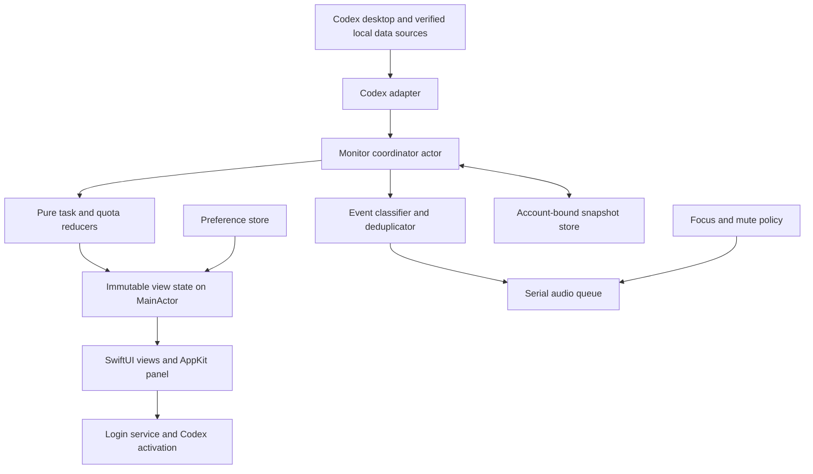

# Status Board Technical Design

> **Current milestone: 0.2.1 build 10.** The user has now requested audio implementation. The preview includes three bundled event sounds, serial playback, manual mute and silent recovery, with 80 passing tests. Focus integration remains deferred: direct audio is not automatically silenced by macOS Focus. The original full-specification Focus requirement below is still a later qualification target. See [current progress](verification/results.md) and [build 10 audio evidence](verification/audio.md).

Version: 0.1  
Date: October 23, 2026  
Status: Implementation design; feasibility gates pending  
Scope: A personal macOS application monitoring Codex

Status Board will use Swift, SwiftUI, and AppKit. The application will run locally, display a persistent desktop widget, and produce short audio alerts from verified Codex events. The critical dependency is a reliable source for the desktop account's task state and actual unread state.

The [product specification](status-board-product-design-v0.1.md) is authoritative for product behavior. This document defines implementation choices and technical contracts. The [implementation plan](status-board-implementation-plan-v0.1.md) defines execution order, verification procedures, and acceptance evidence. Product decisions P01–P12 and acceptance cases A01–A54 remain unchanged.

## 1. Scope and implementation boundaries

The first release provides account quota, three task counts, two persistent widget forms, desktop and pinned window modes, three event sounds, and the three-item settings menu.

The application observes Codex. It does not submit prompts, approve operations, resume conversations, mark results as read, or stop Codex work. Selecting a task count activates Codex without selecting or modifying a conversation.

All product labels remain in English, including the exact task labels `processing`, `Waiting for operation`, and `Done`. `Done` counts currently completed and unread conversations only. It never represents lifetime completions.

The application is a standalone macOS accessory application with a bundled `.app`. An official Codex extension mechanism is not assumed. The existing HTML prototype is a visual reference, not the production runtime or evidence of native capabilities.

## 2. Development baseline and stack

### 2.1 Current execution environment

Rechecked on October 23, 2026 after the user confirmed the toolchain upgrade:

| Component | Observed value | Meaning |
| --- | --- | --- |
| macOS | 15.8.1, build 24H32 | Initial validation host |
| Active architecture | x86_64 | Intel Core i7-8850H confirmed in S00; no second architecture qualified |
| Xcode | 26.3, build 17C529 | Selected at `/Applications/Xcode.app/Contents/Developer` |
| Swift compiler | Apple Swift 6.2.4 | Compiler supplied by the selected Xcode |
| Codex CLI | 0.163.0-alpha.11.2 | Installed protocol version; not a stable compatibility promise |

Version commands succeeded. They also reported sandbox-related cache, file-event, and CLI alias warnings. A Swift 6 Foundation executable now compiles and runs. This does not certify the app or any integration gate; see [environment evidence](verification/environment.md).

The installed Codex executable is currently located at:

```text
/Applications/ChatGPT.app/Contents/Resources/codex-cli/CodexCLI.app/Contents/MacOS/codex
```

This path is an observed location, not a hard-coded product dependency. Resolve the installed application and executable during setup and validate again after application updates.

### 2.2 Toolchain policy

Use the installed Xcode 26.3 and its bundled Swift 6.2.4, as explicitly requested by the user. Set the initial deployment target to macOS 15.0 and use Swift 6 language mode. Initial release qualification is specifically on macOS 15.8.1; the deployment target alone does not certify every macOS 15 release or both CPU architectures.

The selected SDK is macOS 26.2. The installed compiler reports Swift 6.2.4; use observed tool versions rather than inferring the patch version from a compatibility table. No further upgrade is required for the current implementation.

Use the compiler bundled with the selected Xcode. Do not make a separate Swift toolchain, a beta SDK, or an operating-system upgrade a prerequisite. If the toolchain changes, record the new environment and rerun compilation, concurrency checks, window behavior, Focus handling, and packaged-app lifecycle tests.

### 2.3 Technology choices

| Responsibility | Choice | Rationale |
| --- | --- | --- |
| UI composition | SwiftUI hosted inside AppKit | Small declarative card and icon views |
| Window lifecycle | AppKit `NSPanel` and a window controller | Explicit control of level, activation, dragging, and screen placement |
| Frosted material | `NSVisualEffectView` behind the content | Native transparency and blur of content behind the window |
| Business logic | Pure Swift value types and reducers | Deterministic task classification and quota rules |
| Concurrency | Actors, structured tasks, `AsyncStream` | Ordered state updates, cancellation, and isolated mutable state |
| Sounds | `NSSound`, behind an audio protocol | Short bundled audio assets and completion-driven queuing |
| Login startup | `SMAppService.mainApp` | System-managed login-item registration |
| Preferences | `UserDefaults` | Small device-local UI preferences |
| Cached quota | Versioned JSON in Application Support | Account-bound snapshots with explicit timestamps |
| Development | Xcode project plus a local Swift package | Native app packaging and fast core tests |
| Tests | Swift Testing for core logic; XCTest/XCUITest where useful | Deterministic unit tests and selected native integration checks |

Native material depends on its material, blending mode, and system settings. Use behind-window blending and calibrate on actual desktop backgrounds rather than copying CSS blur parameters literally. [NSVisualEffectView](https://developer.apple.com/documentation/appkit/nsvisualeffectview)

`NSPanel` provides panel-specific window behavior, but its use alone does not establish correct fullscreen or Spaces behavior. [NSPanel](https://developer.apple.com/documentation/appkit/nspanel)

## 3. Architecture



### 3.1 Module responsibilities

| Module | Owns | Must not own |
| --- | --- | --- |
| `StatusBoardCore` | Domain types, reducers, event identity, readiness rules, quota formatting | AppKit objects or assumptions about private Codex fields |
| `CodexAdapter` | Transport, decoding, identity, pagination, source revisions, source capability report | UI state or task execution commands |
| `MonitorCoordinator` | Connection lifecycle, bootstrap boundary, reconciliation, account generation | Window operations or direct sound playback |
| `AlertCoordinator` | Event deduplication, eligibility, ordering, suppression | Done counts or Codex read-state mutation |
| `SnapshotStore` | Atomic account-bound quota snapshots and schema validation | Conversation text, credentials, or historical completion totals |
| `BoardViewModel` | Main-thread projection of immutable state and user intents | Network calls inside views |
| `PanelController` | Form, level, screen placement, focus, menu lifecycle | Data-source semantics |
| Platform services | Sound, Focus, login item, Codex activation | Product counting rules |

All asynchronous work has an owner and cancellation path. UI and AppKit mutations run on `MainActor`. Adapter messages are processed through one ordered coordinator; replacing an account or connection invalidates callbacks from older generations.

### 3.2 Planned repository structure

The paths below are implementation outputs, not files already present.

```text
StatusBoard.xcodeproj/                 # Shared StatusBoard scheme
StatusBoard/
  App/                                # Entry point, composition, lifecycle
  UI/                                 # Icon, card, quota rows, task counts, menu
  Window/                             # Panel controller and screen geometry
  Integration/                        # Codex adapter and transport
  Services/                           # Audio, Focus, login, persistence
  Resources/                          # Local icon and three short audio files
  Info.plist
Packages/StatusBoardCore/
  Package.swift
  Sources/StatusBoardCore/
  Tests/StatusBoardCoreTests/
StatusBoardTests/                      # Platform integration tests
StatusBoardUITests/                    # Selected interaction tests
Probes/                               # Disposable feasibility executables
Fixtures/                             # Synthetic or sanitized source fixtures
scripts/                              # Build, test, probe, and evidence helpers
docs/verification/                    # Gate reports and acceptance results
artifacts/                            # Local build evidence; ignored by Git
```

Use a minimal checked-in Xcode project and shared scheme. The local package has no third-party dependency initially. Adding a project generator or runtime library requires a concrete benefit and a pinned version, not an automatic setup dependency.

## 4. Codex integration and feasibility gates

### 4.1 Established interface facts

The official app-server documentation describes JSON-RPC initialization, account rate-limit reads, thread state notifications, and turn completion events. It also distinguishes stored threads from loaded runtime threads. A terminal event can represent success, interruption, or failure, so it is not automatically a successful completion. The inspected page does not establish a desktop unread-state contract. [Codex app-server documentation](https://learn.chatgpt.com/docs/app-server)

The installed CLI help additionally exposes `app-server proxy --sock` and `generate-json-schema --out`. Their presence proves command availability only. It does not prove that a usable desktop control socket exists or that connecting to it exposes the required account-wide state.

Tools available to the assistant inside the Codex app are not assumed to be callable APIs for an independently installed Status Board application.

### 4.2 Source selection order

1. Inspect the installed protocol schema and supported local connection options.
2. Test a documented connection to the actual desktop runtime, if one is available, with read-only operations.
3. Use a separate app-server process only for capabilities it demonstrably provides. A successful quota read does not validate desktop task monitoring.
4. If necessary, investigate a versioned read-only local metadata source. Establish ownership, account identity, unread semantics, update ordering, and compatibility before adopting it.
5. Record the chosen source and field mapping. If required semantics remain unavailable, stop the dependent feature and present the precise product impact.

A metadata fallback must not require writing Codex files, modifying its database, bypassing access controls, or continuously scraping task content. An undocumented source is a compatibility risk and needs explicit version detection and a controlled failure path. It is not automatically selected when an API probe fails.

Use the current account through the selected source's supported authentication path. Inspect authentication status without exporting credentials. If interactive sign-in is required, let the user complete it in the supported flow; do not silently replace desktop authentication or introduce an API key as a substitute for account quota. Treat expired authentication and an unsupported source version as explicit unavailable states. Record the exact login prerequisites and tested source version in the integration report.

### 4.3 Required capabilities

| Gate | Required evidence | Failure consequence |
| --- | --- | --- |
| G1 — Identity and quota | Stable account identity; real quota cycles, percentages, optional reset times; account-switch detection | Block live quota and account-bound caching |
| G2 — Task coverage | Latest state for all visible, unarchived, top-level desktop-account conversations, including applicable CLI and cloud sources | Block claims of complete task counts |
| G3 — Actual unread state | Reading a completed result in Codex changes its observed unread state; opening Status Board does not | Block `Done`; do not substitute a local clear button |
| G4 — Event continuity | Distinguish current snapshot, replay, new completion, and separate waiting episodes; establish an ordered bootstrap boundary | Block reliable once-per-event audio |
| G5 — Native window behavior | Desktop, pinned, fullscreen, Spaces, and screen-removal behavior on the target host | Block release of the affected window contract |
| G6 — Focus suppression | Reliable interpretation of the required Focus behavior, including authorization and unknown status | Block automatic audio qualification |
| G7 — Packaged lifecycle | Login-item state, repeat launches, quit, and signed-bundle behavior in the intended install location | Block installable-release qualification |

G1–G7 start as `NOT_RUN`. Documentation research and environment version reads do not pass them. Independent implementation may continue while a gate is unresolved, but a mock implementation cannot satisfy a live integration gate.

## 5. Internal data contracts

These are application-owned models. Field names below are not claims about the Codex wire schema. The adapter must supply a tested mapping from the selected source.

| Model | Required information |
| --- | --- |
| `AccountKey` | Stable opaque identity of the current account; namespace sufficient to avoid cross-account collisions |
| `TaskRecord` | Account key, conversation ID, top-level/parent relationship, current run ID, archive flag, source revision, normalized execution state, read state for the current completion |
| `TaskState` | `processing`, `waitingUser`, `waitingError`, `completed`, `stopped`, `idle`, or `unknown` |
| `ReadState` | `unread`, `read`, or `unknown`, associated with the current completed run |
| `QuotaWindow` | Stable bucket/window key, duration or authoritative label, valid remaining percentage, optional reset time |
| `MonitorSnapshot` | Account, complete scoped task set, quota result, source cursors/revisions, completeness flags, successful-sync time |
| `MonitorEvent` | Account, conversation and run IDs, kind, stable occurrence identity, source order, source time if provided, receipt time, connection generation |
| `ConnectionState` | `disconnected`, `bootstrapping`, `live`, or `recovering`; only connected/disconnected is exposed in the UI |
| `FocusState` | `allowsAudio`, `suppressesAudio`, or `unknown`; include observation freshness and authorization status internally |

Do not use `0`, an empty list, or `false` as a substitute for an unavailable value. Missing optional reset times do not invalidate an otherwise successful quota read. Missing essential account identity, unread information, or task coverage does invalidate a complete task snapshot.

An empty task page is not a complete task set until pagination finishes successfully. Apply removals and archive filtering only after a complete scoped reconciliation. Reject an old account generation or stale source revision before changing visible state.

## 6. Task reduction and event semantics

### 6.1 Counts

Reduce to one latest record per `(account, top-level conversation)` and exclude archived conversations. Use verified parent relationships to fold subagents into their parent; do not treat every forked conversation as a subagent.

| Latest verified state | Count contribution |
| --- | --- |
| Executing, including automatic retry | `processing += 1` |
| Requires an answer or approval | `Waiting for operation += 1` |
| Failed and stopped, requiring user intervention | `Waiting for operation += 1` |
| Completed and unread for the current run | `Done += 1` |
| Completed and read, intentionally stopped, or idle | No contribution |
| Unknown required state | Unavailable task aggregate; never a fabricated zero |

Starting a new run removes the previous run's Done contribution. Read-state changes update counts without generating a new sound. Merely foregrounding Codex does not let Status Board assert that a result was read.

### 6.2 Sound events

Count reduction and event detection are separate. A new successful completion can sound even when its result is already read. A stale event cannot roll back the latest task state, but a provably new eligible event still follows the event delivery contract.

| Event | Sound |
| --- | --- |
| Successful run completion | Completion sound |
| New explicit user-input or approval episode | Ordinary waiting sound |
| New stopped failure requiring intervention | Error sound |
| Retry, intentional stop, read-state change, quota change | None |

Prefer a source event ID. Otherwise require a verified occurrence key equivalent to `(account, conversation, run, kind, occurrence)`. Separate approval episodes within the same run must have separate identities. A wall-clock timestamp or the current state string alone is not a sufficient deduplication key.

Maintain an event ledger for the active monitoring generation. Deduplicate before enqueueing and record suppressed events as consumed. Cursor-based retention may prune old ledger entries only after the adapter proves that those events cannot reappear as new. If the source has no bounded replay or retention contract, G4 remains unresolved; do not silently clear the ledger or force periodic reconnects that discard eligible events.

## 7. Bootstrap, recovery, and connection health

### 7.1 Snapshot and event boundary

Use a source cursor, revision, or another demonstrated ordering boundary:

1. Create a new connection generation; disable audio admission.
2. Establish account identity and subscribe or begin observation while buffering events.
3. Fetch a complete snapshot and determine its source boundary.
4. Reconcile buffered messages with that boundary and install the current snapshot.
5. Consume snapshot/replay events silently; admit only events proven to occur after the live-monitoring boundary.
6. Enable audio admission and maintain periodic state reconciliation.

The exact handshake depends on the selected source and must be documented by G4. A local timestamp comparison alone cannot prove ordering across delayed or replayed messages. A polling-only adapter must demonstrate how it detects short-lived intermediate events; otherwise it cannot pass G4.

Apply this sequence on first launch, process restart, wake, account change, stream discontinuity, and reconnection. Historical unread and waiting items restore visual state only. Events that occurred while disconnected do not generate catch-up sounds.

### 7.2 Unified connection behavior

The coordinator can track individual source health internally, but publishes one product connection status. Live status requires a verified account, complete task/read-state coverage, and a successful quota response, allowing explicitly optional quota fields to be absent.

On a transient failure, hold the last coherent state while retrying and suspend admission of uncertain audio events. On explicit Codex shutdown, account loss, a known stream gap, or sustained failure, cancel pending audio, gray the widget, freeze quota, remove the collapsed `!`, and show `—` for all task counts.

During a retry grace period, do not present a mixture of newly read quota and stale tasks as a new complete sync. Recovery from an uncertain observation gap uses a fresh silent bootstrap even if the UI never reached the disconnected timeout.

Continue low-cost availability checks while disconnected. Do not refresh the displayed quota independently. Persist `lastCompleteSyncAt` only after a complete valid reconciliation for the current account. Task events can update counts between reconciliations without advancing that timestamp.

### 7.3 Initial tuning values

These are engineering starting values, not measured performance or changes to product semantics. Freeze or revise them using S01/S08 measurements.

| Parameter | Initial value |
| --- | --- |
| Task updates | Verified event stream preferred; incremental reconciliation every 5 seconds |
| Polling fallback | At most one incremental task read every 2 seconds, only if G4 passes |
| Quota refresh | Every 60 seconds while connected, plus validated source notifications |
| Read request timeout | 5 seconds |
| Recovery retry delay | 1, 2, 4, then 8 seconds, with bounded jitter |
| Sustained-failure threshold | 15 seconds from the first unresolved critical failure |
| Disconnected availability probe | Every 15 seconds; suspend while the system sleeps |
| Explicit desktop shutdown | Transition on lifecycle observation, target within 2 seconds |

Measure both task and quota paths. A quiet event stream is not automatically unhealthy; use a verified heartbeat or read probe. Avoid downloading full conversation histories on a timer.

## 8. Quota normalization, timestamps, and persistence

Validate percentages as finite numbers in `[0, 100]`. When a source reports used percentage, compute remaining as `100 - used`. Reject invalid values instead of converting them to exhaustion or unlimited usage.

Use `floor(remaining)` for the displayed integer. The text, progress fill, and color use that same normalized integer: greater than 40 is green, 21–40 is orange, and 0–20 is red. For example, 40.9 displays as 40% in orange. This conservative rounding is an implementation choice under the product's integer-display rule.

Use actual source windows. Do not assume exactly two windows or rename an unfamiliar duration to weekly. Prefer an authoritative label; otherwise derive a clear English duration label from a valid duration. Missing reset times produce `Reset at —`.

Use English local date/time formatting, including the date and local time-zone abbreviation, for `Reset at …` and `Last updated …`. Reformat after a time-zone change without altering stored UTC instants. Tooltip display, view redraws, failed reads, and reset deadlines never advance the saved sync time.

### 8.1 Stored data

| Store | Contents | Lifecycle |
| --- | --- | --- |
| UI preferences | Expanded state, Pin, frame/screen identity, mute preference | Persist after successful changes |
| Login preference | User's intended value plus observed system registration status | Reconcile with the system at startup and after settings changes |
| Quota snapshot | Schema version, account key, valid quota windows, optional reset times, complete-sync time | Atomic replacement after a valid complete sync |
| Diagnostics | Source versions, event categories, timings, redacted errors | Bounded local retention; no raw task content |

Write JSON through an atomic replacement. A corrupt or unsupported snapshot becomes unavailable, not a crash. Cache task bodies, access tokens, and raw conversations nowhere in Status Board.

Only load a quota cache after establishing that it belongs to the current account. Before identity is known, show unavailable data. Once an active account has been verified, disconnecting can retain its last quota snapshot. An account switch immediately clears old counts, quota, timestamps, buffered events, and audio before any new data arrives.

Crossing a cached reset time while disconnected does not refill quota. Task counts are rebuilt from a new source snapshot, never restored as live facts from disk.

## 9. Native window and interface behavior

### 9.1 Panel ownership and layering

Use one long-lived panel and one application instance. Change its content and size between the icon and card forms while preserving its location anchor and Pin state. A second app launch should reveal or reuse the existing instance rather than create another widget.

Prototype a desktop-level panel below ordinary application windows and a pinned panel above ordinary windows. Select exact window levels and collection behaviors after testing full-screen applications, Spaces, Finder interaction, and Mission Control. Do not use an excessively high screen-saver level as an untested shortcut.

The panel must not activate or raise itself when a task event arrives. Expansion remains until an explicit collapse action. A dropdown dismissal must affect only the dropdown. The title icon and collapse button collapse; title blank space drags.

Use one screen identity plus a frame in logical points. Clamp restored and resized frames to the chosen screen's visible frame. Preserve the current screen when the pointer or foreground application moves. On display removal, place the single widget inside the main screen's visible frame while retaining form and Pin.

### 9.2 Visual translation

Start from a 320-point expanded width, 20-point corner radius, 16-point padding, and a 54-point icon frame. Percentage text is 14 points; task numbers are 20 points; labels are 11 points. Calibrate rather than assuming CSS pixels and native points produce identical appearance.

Use the approved ChatGPT mark as a local bundled resource. Header controls are ordered Settings, Pin, Collapse. Keep `Waiting for operation` complete, wrapping if needed. Do not add the removed subtitle or prototype configuration controls.

The collapsed form shows only the top-right `!` when at least one verified waiting task exists. It never shows completed-unread or processing counts. In the expanded card, Done retains its unread indication until Codex reports those results as read.

Check light, dark, and visually complex backgrounds, increased contrast, and reduced transparency. System accessibility preferences may increase opacity; readability takes priority over a fixed material alpha. Provide accessibility labels, keyboard access, and a non-color way to understand quota and task states.

### 9.3 Menu and activation

The gear opens an anchored native menu with exactly `Mute Sounds`, `Launch at Login`, and `Quit`. The first two are checkable and default to unchecked. Close on selection, outside click, a repeated gear click, Escape, or card collapse. Opening or closing the menu does not move card content or change expanded state.

Activate Codex using the resolved installed application identity. If the application cannot be resolved, retain the widget and disconnected state; do not redirect to an arbitrary executable or browser page.

## 10. Sound, Focus, and lifecycle

### 10.1 Audio queue

Bundle three distinguishable short sounds, initially targeting 0.3–0.8 seconds each. Use playback completion to start the next sound, with a small fixed gap if listening tests require it. Follow system volume; provide no separate volume or sound-picker UI.

Before playback and before every queued item, check manual mute, current Focus policy, monitoring generation, and connection readiness. Starting mute, Focus suppression, disconnect, account change, sleep, or quit cancels queued sounds. Also stop an active sound when practical. A cancelled or suppressed event is consumed and is never replayed after recovery.

All eligible distinct events play once during continuous healthy monitoring, including when Codex is foreground. Restart behavior deliberately restores a silent baseline rather than replaying an interrupted queue. Audio-device or playback failures produce diagnostics and must not create a retry loop that repeatedly plays an event.

### 10.2 Focus is a feasibility requirement

Implement a `FocusStatusProvider` abstraction. Investigate the public Focus-status APIs and their authorization behavior, but do not assume that an ordinary application can obtain a reliable global Focus switch. Apple describes Focus status in terms of notification availability and authorization. [INFocusStatusCenter](https://developer.apple.com/documentation/intents/infocusstatuscenter), [isFocused](https://developer.apple.com/documentation/intents/infocusstatus/isfocused-78wbx)

G6 must cover Focus on/off, status-sharing disabled, authorization denied or revoked, unknown status, and an app allowed through a Focus profile. Prove that the chosen mechanism satisfies the product requirement rather than silently redefining it as notification eligibility.

`NSSound` playback is gated by application logic; do not assume a direct sound call automatically honors Focus. During probes, an unknown Focus state suppresses audio conservatively. Permanent silent operation is not a passing implementation of the default-sound requirement. If a valid public integration cannot satisfy the contract, record the limitation and seek a product decision before release. Do not silently add notification banners or privileged private-system-file monitoring.

### 10.3 Login, wake, and quit

Use `SMAppService.mainApp` and its actual registration status. Registration can require approval or fail; persist the user's intent but do not display an enabled checkbox when the system has not enabled the service. If approval is required, direct the user to the relevant system setting through the existing control flow. [SMAppService](https://developer.apple.com/documentation/servicemanagement/smappservice)

Verify login startup from the final installed `.app` path with the chosen signing identity. Unsigned development launches do not certify this behavior.

On wake, invalidate transport continuity, clear audio, and bootstrap silently. Quit cancels Status Board tasks, observation, and audio and closes its connections. It may terminate a helper process it created exclusively; it must not terminate a shared Codex service or any Codex task.

## 11. Quality targets and observability

These are initial engineering acceptance targets. Record actual measurements and revise only with an explanation; do not label them as achieved before testing.

| Measure | Initial acceptance target |
| --- | --- |
| Local UI action | p95 response within 100 ms across 50 expand/collapse/Pin/menu actions |
| Task/read-state propagation | p95 within 3 seconds and maximum 5 seconds across at least 20 observed transitions |
| Audio admission | First eligible sound begins within 1 second of normalized event receipt when the queue is empty |
| Quota freshness | Updated within 65 seconds of an observable upstream change under normal connectivity |
| Duplicate events | Zero duplicate sounds or duplicate task contributions in deterministic replay and real checks |
| Idle CPU | Average below 1% of one CPU core over 10 minutes after warm-up |
| Memory | Widget resident memory below 100 MiB and incremental owned helper memory below 150 MiB after warm-up |
| Stability | No crashes or unbounded queue growth in a 2-hour session; memory drift below 20 MiB after warm-up |

CPU and memory measurements include incremental helper costs attributable to Status Board and identify unrelated Codex workload separately. Measure native animations on the target host; a browser prototype is not a performance proxy.

Log connection generations, redacted event identities, bootstrap boundaries, suppression reasons, queue transitions, source read durations, and complete-sync times. Default diagnostics must omit task titles, content, account emails, authentication payloads, and access tokens. Keep a bounded rolling log, initially 5 MiB across three files.

## 12. Build, packaging, and compatibility

Build a native app target and a separately testable core package. Keep production entry points independent from fixture injection; development fixtures must not appear as real data in a release build.

Target the current machine first. Verify the hardware architecture in S00 before choosing a release architecture. Cross-compilation alone does not certify a second architecture.

For personal local use, use the least complex signing arrangement that passes G6/G7 and preserves a stable bundle identity. Document the actual signing mode. If a capability requires a developer account or entitlement unavailable on this host, report the exact blocker; do not assume unsigned or ad-hoc signing is sufficient.

Deliver a `.app`, build instructions, the selected source compatibility record, verification results, and known limitations. Public distribution, notarization for other users, automatic updates, and Mac App Store submission are outside this release's scope.

## 13. Decisions that require evidence

The execution plan must resolve and record these before qualification:

1. Actual desktop data connection, scope completeness, account identity, and unread mapping.
2. Event identity and snapshot boundary that prevent duplicate and historical sounds.
3. Public Focus integration and its authorization/unknown-state behavior.
4. Window levels and collection behaviors proven on the current macOS version.
5. Final refresh, timeout, reconciliation, and log-retention values after measurement.
6. Signing, install location, login-item handling, and architecture scope.

Routine implementation choices can be resolved during execution. A technical limitation that changes an accepted product behavior must be surfaced with evidence and alternatives; it must not be hidden by marking a requirement complete.

## 14. Execution evidence update

The upgraded toolchain compiled the independent app scaffold, core tests and native probe. Experimental installed schema exposes read-state maps and workspace identity. A user-confirmed desktop read changed a private desktop state entry but had no durable receipt row for that conversation. The standalone server does not mirror desktop runtime state. See [source decision](verification/codex-integration.md), [native feasibility](verification/native-feasibility.md), and [all statuses](verification/results.md). G1–G7 are not yet passed; production adapter/window/Focus decisions are not frozen.
